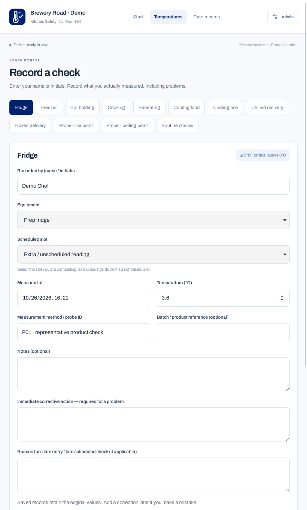
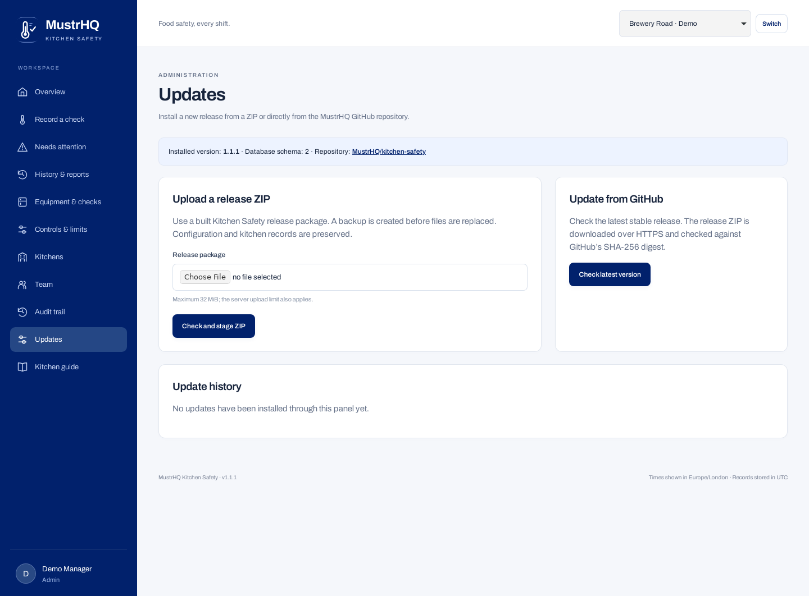
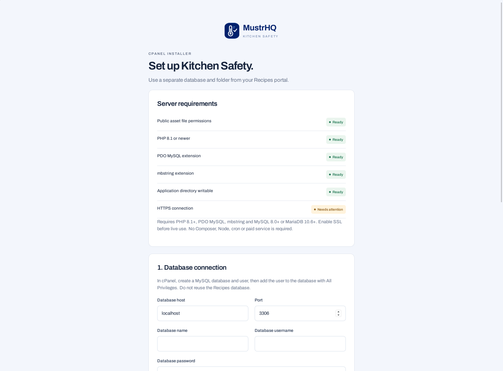

# Kitchen Safety preview gallery

Actual application screens from **v1.1.1**, captured on 26 October 2026 using fictional demo data. These are screenshots of the running PHP application, including its real forms and database-backed screens.

[Back to the project](../../README.md) · [Download v1.1.1](https://github.com/MustrHQ/kitchen-safety/releases/tag/v1.1.1)

## Kitchen frontend

The starting screen for the kitchen tablet, with shortcuts to temperature checks, date records, cooling and daily routines. Staff use the frontend without an account; names are self-reported.

## Tablet temperature entry

Portrait tablet layout showing a fridge check, equipment selection, measured time and temperature, probe reference and corrective-action fields. Saving requires an online connection.

## Date history

Filter records by date, check type or recorder. The demonstration includes passing readings, an out-of-limits hot-holding record and a cooling batch still in progress.

## Admin overview

The protected manager dashboard shows recorded and overdue scheduled checks, open exceptions and links to food checks.

## ZIP and GitHub updates

The admin Updates screen supports uploading a built release ZIP or checking for a stable GitHub release. The installed version shown here is 1.1.1.

## Installer

The installer checks server requirements before database and administrator setup. This screenshot uses a local HTTP test server, so the HTTPS check correctly shows **Needs attention**. Production installations require HTTPS.

