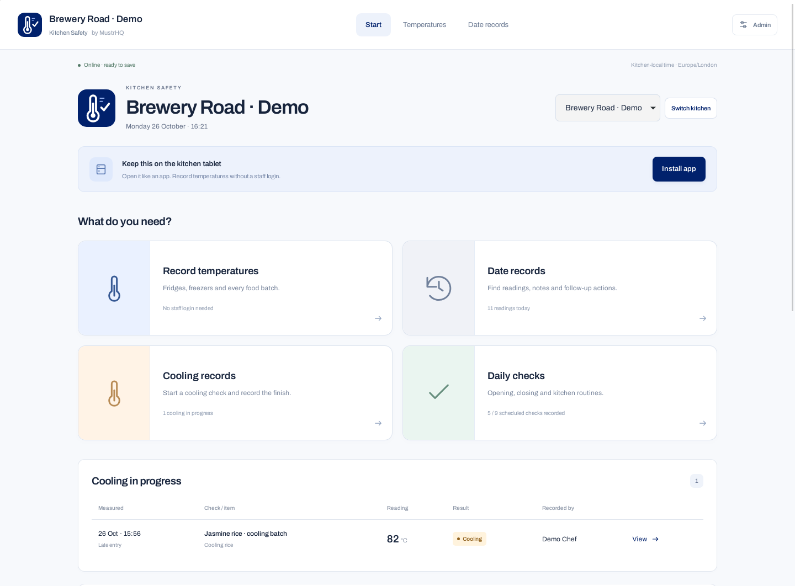
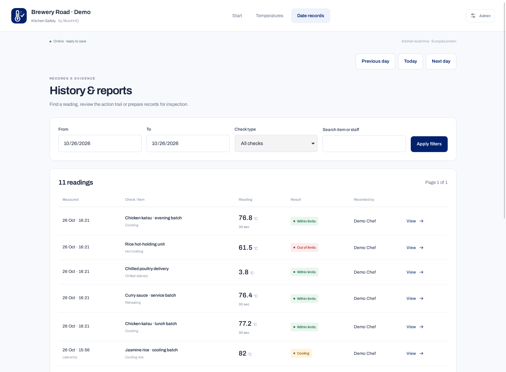
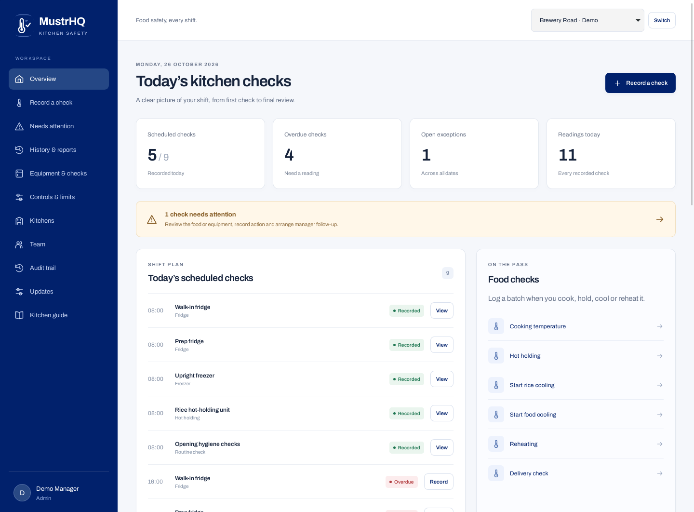

<picture><source media="(prefers-color-scheme: dark)" srcset="assets/brand/wordmark-white.svg"></picture>

<strong>Temperature records for the kitchen tablet. A separate admin panel for the manager.</strong> Plain PHP + MySQL. Self-hosted. Open source.

<a href="https://github.com/MustrHQ/kitchen-safety/releases">Downloads</a> · <a href="docs/INSTALL.md">Install</a> · <a href="docs/UPDATES.md">Updates</a> · <a href="docs/TABLET.md">Tablet app</a> · <a href="CHANGELOG.md">Changelog</a>

## Preview

Actual application screens from **v1.1.1**, using fictional demo data. This release includes the public-asset permissions fix for cPanel installations. [Download v1.1.1](https://github.com/MustrHQ/kitchen-safety/releases/tag/v1.1.1).

*The kitchen frontend: staff can record measured temperatures without signing in.*

| Date history | Protected admin panel |
| --- | --- |
|  |  |
| Find readings and follow-up records by date. | Review scheduled checks and items needing attention. |

[View all six previews](.github/previews/README.md), including tablet entry, ZIP/GitHub updates and the installer.

## Two clear parts

| Kitchen frontend | Protected admin panel |
| --- | --- |
| Open the main address; no staff login. | Open `admin/`; sign in with an individual account. |
| Enter a name or initials and save a measured temperature. | Manage kitchens, equipment, check times and controls. |
| View records by date, food/check type or recorder name. | Review exceptions, record final dispositions and daily reviews. |
| Add corrective-action notes, follow-up readings and cooling finishes. | Export CSV and printable reports; manage accounts and the audit trail. |
| Install on a tablet as a PWA, with a local unsaved-draft helper. | Stage release ZIPs, check GitHub and install verified updates with backups. |

Frontend names are self-reported, not authenticated staff identities. Anyone who can reach the frontend can see active-kitchen history and submit checks. Manager resolutions, account changes, settings, reports and software updates require the protected backend. Restrict access at your web server/network if the frontend is intended only for your premises.

## What it records

- Fridges, freezers and hot-holding equipment, with daily schedules.
- Cooking and reheating, including continuous holding time.
- Cooling food and rice: start, deadline, finish temperature and chilled-storage location.
- Chilled/frozen deliveries, supplier and condition checks.
- Probe checks and custom opening/closing or hygiene routines.
- Original readings, limit snapshots, named follow-ups, corrections and manager decisions.

A follow-up never silently replaces the original check. A passing recheck does not erase an earlier failure. Limits and timetables retain their historical context. Starting controls require validation against the kitchen's actual HACCP plan; see [food-safety assumptions](docs/FOOD-SAFETY-DEFAULTS.md).

## Install on cPanel

Requires **PHP 8.1+**, PDO MySQL and mbstring, **MySQL 8.0+ / MariaDB 10.6+**, and HTTPS. Enable `zip` for ZIP updates and `curl` for GitHub updates. No Composer, Node build, cron or paid service is required.

1. Download a built release ZIP. Extract its folder to a separate web directory; keep `.htaccess` files.
2. Create a new MySQL database/user and grant that user privileges on that database.
3. Open `install.php`. Enter the database details, first kitchen, time zone and administrator account.
4. Delete `install.php`. Open `admin/`, add equipment and check times, and review the controls.
5. Open the main address on the kitchen tablet. Staff can begin entering checks without signing in.

Full instructions: [installation](docs/INSTALL.md). Upgrading an existing **1.0.0** installation requires one manual file upload first, because 1.0.0 had no updater. Preserve `config.php` and the database; the schema migration keeps existing records. See [upgrade instructions](docs/UPDATES.md).

## ZIP and GitHub updates

The admin Updates screen stages a built release and displays its version before installation. It checks the application ID, version, paths and every file hash; rejects traversal, symlinks, duplicate names, missing files and extraction bombs; and keeps configuration and operational storage out of update packages. Installation creates a private database/affected-file backup and pauses kitchen requests while changing files. File errors trigger file rollback. A database migration failure keeps maintenance enabled for recovery from the private backup.

GitHub checks use the latest stable release of `MustrHQ/kitchen-safety`. The updater downloads the named installable ZIP and verifies GitHub's SHA-256 asset digest, then uses the same staging/install process. No personal access token is needed for this public repository. A built release asset must be published; GitHub's automatic source-code ZIP is not an update package.

## Tablet PWA

Open the frontend over HTTPS. On iPad, use Safari > Share > Add to Home Screen. On Android, use the browser's Install app/Add to Home screen option. The app has its own icon, standalone launch and touch-friendly layout.

**Saving records requires a connection.** A local draft is not a saved record, and the app does not silently queue readings. The service worker caches the static shell and an offline explanation; it does not cache admin pages or temperature histories. Reconnect, restore the draft if needed and submit it using its real measured time. See [tablet guidance](docs/TABLET.md).

## Development and releases

From a GitHub source checkout, run `php tests/domain.php` for temperature/time boundary checks. `python3 scripts/build-release.py --output dist` builds the installer/update ZIP and SHA-256 file, excluding configuration, backups and operational data. GitHub Actions validates PHP and domain tests; tagged releases build and publish the installable asset. See [contributing](CONTRIBUTING.md).

The portal supports HACCP monitoring evidence. It does not replace a business-specific HACCP plan, staff training, calibrated probes or competent food-safety review. It has no sensor integration, automated alert delivery or certification claim. A database/hosting administrator can still alter the database; maintain independent backups.

## Licence and the MustrHQ family

New combined releases are licensed under **GNU AGPL-3.0**. The original Kitchen Safety 1.0.0 components retain their MIT notice in [NOTICE](NOTICE); the bundled Archivo font uses the SIL Open Font License. The interface follows the established [MustrHQ Recipes](https://github.com/MustrHQ/recipes) design family.

Also explore [Rota](https://github.com/MustrHQ/rota), [Stock](https://github.com/MustrHQ/stock) and [Recipes](https://github.com/MustrHQ/recipes).
